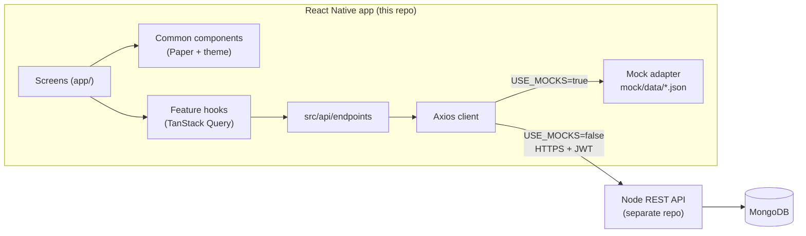

# Paws N' Play - Architecture & Requirements

> Living document. Update it whenever scope, data model or API changes.
> Last updated: 23 Nov 2026 - Phase 1 (admin boarding board: capacity, occupancy calendar, dog history, payments & billing).

## 1. Product overview

**Paws N' Play** runs its own **dog boarding** facility. Customers book stays (check-in to
check-out) and the team manages dogs, kennels and capacity on the ground.

The app is one React Native (Expo) codebase for Android and iOS with role-based areas:

| Role | Who | Phase 1 (now) | Later |
|---|---|---|---|
| `admin` | Owners / managers (Kush, Divya, Shreya) | Full boarding board | + settings, users, reports |
| `staff` | Kennel staff | "Coming soon" screen | Check-in/out, daily care log |
| `user` | Customers (dog parents) | "Coming soon" screen | Own dogs, request bookings, history |

### Phase 1 goal
An **admin board** for managing boarding manually:
- Add and maintain dogs (with owner contact and care info).
- Create bookings by hand: **check-in date + time -> check-out date + time**.
- Manage bookings: edit, check in, check out, cancel.
- Filter bookings by **month**, a specific **date**, and **status**.
- A **dashboard**: live capacity (editable), today's arrivals/departures, upcoming stays, an **occupancy calendar**, payments due, dog lookup.
- **Dog history**: every stay a dog has had, with totals.
- **Payments & billing**: record advances/payments/refunds per booking; monthly expected / received / due.

Customer accounts are not linked yet: owner name/phone live on the dog. Later each dog gets an
`ownerId` (customer user) and customer-app bookings arrive as `pending` for admin approval.

## 2. Requirements

### 2.1 Functional - Phase 1
**Auth**
- F1. Email + password login. Admins land on the admin dashboard; other roles see a placeholder.
- F2. Session persists securely on device (expo-secure-store); logout clears it.

**Dogs**
- F3. List dogs; search by dog name, breed, owner name or phone; switch Active / Archived.
- F4. Add dog: name*, breed, gender, date of birth, weight, colour, temperament (friendly/shy/reactive),
  owner name*, owner phone*, vaccinated (+ valid-until date), neutered, feeding notes, medical notes, notes,
  **vaccination records**: attach photos (camera / gallery) or PDFs (max 10 MB each, up to 10 per dog);
  images open in an in-app viewer, PDFs open in the phone's viewer via the share sheet; remove before saving.
- F5. View dog: profile, owner, health & care, all stays; "New booking for <dog>".
- F6. Edit dog. Archive / restore dog (archive blocked while it has upcoming or active stays).

**Bookings**
- F7. Create booking: dog, check-in date + time, check-out date + time, price per night
  (default from settings), kennel (optional), notes. Shows nights × price = total.
- F8. Validation: check-out after check-in; dog not already booked in overlapping dates;
  facility not over capacity at any moment in the stay.
- F9. Booking detail: dates, nights, amount, kennel, notes, dog's owner/feeding/medical info.
- F10. Actions: Check in, Check out, Cancel (with confirmation). Edit dates/details while
  `confirmed` or `checked_in` (dog locked after check-in).
- F11. Bookings list filtered by month (‹ › switcher), optional single date, and status chips.
  Shows count summary.

**Dashboard**
- F12. In boarding now: checked-in count / capacity, free kennels, progress bar (warning ≥ 80%, red at full).
  **Edit capacity** from this card (cannot go below dogs checked in now).
- F13. Today: number of check-ins and check-outs, stays this month; **payments due** (amount + bookings) -> Billing.
- F14. **Occupancy calendar**: month view, each day shows peak dogs booked / capacity, coloured
  (space / 80%+ / full), dot when dogs arrive. Tap a day -> sheet with booked/free, arriving / staying /
  leaving dogs (tap -> booking), and "New booking from this date". Past days faded.
- F15. Lists: arriving today (with "Check in"), leaving today (with "Check out"), upcoming 7 days.
- F16. Quick actions: New booking, Add dog, **Find a dog** (search -> dog profile). Pull to refresh; auto-refresh 60 s.

**Dog history**
- F17. Bookings tab **Dog** filter: shows that dog's stays across all months (newest first) with a
  summary: stays, nights, total amount, with-us-now / next visit, last visit, cancellations.
- F18. Dog profile shows the same summary, split into Current & upcoming and Past stays.

**Payments & billing**
- F19. Each booking has payments: type (advance / payment / refund), amount, method (UPI / cash / card / bank),
  date received, note. Booking shows Total / Received / Due with progress; payments list with Remove (fix mistakes).
- F20. "Record advance / payment / refund" sheet with quick amounts (50% advance, full balance, full refund).
  Cannot pay more than the balance; refunds cannot exceed what was received; cancelled stays accept refunds only.
- F21. Booking cards show amount and a payment badge (Paid / ₹X due / Unpaid / Refund ₹X).
- F22. **Billing tab**: period chips **This week / Next week / Last week / Month (‹ › switcher) / Custom (from-to dates)**;
  weeks run Monday-Sunday. For stays **checking in** in the period: Expected, Received, Due, % collected,
  advances, paid/part-paid/unpaid counts. **Collected in this period** = money actually received in those dates
  (any stay, refunds deducted). Total outstanding across all months; list filter Due / Paid / All.

**Settings**
- F23. Boarding settings (Profile -> Boarding settings): capacity, price per night, default check-in/out times, facility name.

### 2.2 Non-functional
- Android + iOS from one codebase; runs in Expo Go during development.
- Minimal, easy UI: white background, black text, logo pink accents; touch targets ≥ 44 pt; accessible labels.
- Theme defined once and changeable in one place. UI built only from common components.
- All business rules enforced by the backend (the app also validates for fast feedback).
- Dates stored in UTC; shown in the device's local time (facility timezone Asia/Kolkata).
- Works against a mock backend until the Node API exists - switching is an env flag.

## 3. Tech stack

| Layer | Choice |
|---|---|
| Client | React Native + **Expo SDK 58**, TypeScript (strict), **Expo Router** (file-based navigation) |
| UI kit | **React Native Paper** (Material Design 3) wrapped by our common components, themed by our brand theme |
| Server state | TanStack Query (caching, refetch, invalidation) |
| Client state | Zustand (session) |
| HTTP | Axios client with auth header + error normalisation; mock adapter in dev |
| Secure storage | expo-secure-store (tokens) |
| Backend (separate repo) | **Node.js REST API** (e.g. Express/Fastify) |
| Database | **MongoDB** (Mongoose) |
| Builds | EAS Build (development / preview / production) |

## 4. System architecture



### 4.1 Client folder structure
```
app/                         Expo Router routes
  _layout.tsx                ThemeProvider, QueryClient, session bootstrap
  index.tsx                  redirect to /login or role home
  faqs.tsx                   PUBLIC FAQ page (/faqs) - no RoleGate, works logged out (phone + web)
  know-your-dog.tsx          PUBLIC "Know Your Dog" questionnaire (/know-your-dog) - no RoleGate, posts to POST /questionnaires
  (auth)/login, register
  admin/
    _layout.tsx              RoleGate(admin) + Stack
    (tabs)/                  Dashboard | Bookings | Billing | Dogs | Profile
    booking/new, booking/[id]
    dog/new, dog/[id]
    settings                 boarding settings
    forms/index, forms/[id]  Know Your Dog submissions (list + detail; opened from the dashboard card)
  user/, staff/              placeholders (Phase 2+)
src/
  api/                       client.ts, types.ts, endpoints/, mock/ (adapter, routes, db)
  auth/                      session store, token storage, RoleGate, roles, permissions
  components/common/         UI kit (see 4.3)
  components/navigation/     tab/stack options, tab icons
  features/                  bookings/, dogs/, dashboard/ (calendar, day sheet), payments/, settings/, faqs/ (public FAQ content), knowYourDog/ (public questionnaire: fields as data, logic, form pieces), questionnaires/ (admin view of submissions: hooks, answer grouping from kydData, cards, actions), public/ (shared public header) - hooks + feature components
  theme/                     palette -> themes -> paperTheme, ThemeProvider, makeStyles
  utils/                     date.ts (local date/time helpers), format.ts
mock/                        endpoints.json + data/ (users, dogs, bookings, settings, questionnaires)
docs/                        ARCHITECTURE.md (this), api-contract.md
```

### 4.2 Theme
`palette.ts` (brand hex: pink `#C2A1BE`, black `#262727`, white) -> `themes.ts` (semantic tokens:
`colors.primary/text/border...`, spacing, radius, sizes, typography) -> `paperTheme.ts` (Paper MD3
theme generated from the tokens). Screens use `makeStyles((t) => ...)` / `useTheme()` only.
Contrast rule: pink fills carry black text; pink text on white uses `colors.primaryText`.

### 4.3 Common components (`src/components/common`)
AccordionItem, AppText, Button, TextInput, NumberStepper, PickerField, DateField, TimeField, Calendar, SelectField, SelectSheet, Chip,
SegmentedControl, SwitchField, CheckboxField, SearchBar, Card, Badge, Avatar, InfoRow, SectionHeader, Divider,
InlineAlert, ProgressBar, MonthSwitcher, Sheet, Fab, Icon, Logo, Screen, StateView.
Screens never import Paper directly. Date/time pickers are pure JS (work in Expo Go).

### 4.4 Data flow
Screen -> feature hook (`useBookings`, `useCreateBooking`...) -> `bookingsApi` -> axios ->
mock adapter or real API. Mutations invalidate `bookings`, `dogs` and `dashboard` queries.

## 5. Data model (MongoDB)

All documents have `_id` (exposed as `id`), `createdAt`, `updatedAt` (timestamps: true).

### users
| field | type | notes |
|---|---|---|
| name | string | |
| email | string | unique, lowercase |
| passwordHash | string | bcrypt; never returned |
| role | `admin` \| `staff` \| `user` | |
| phone | string? | |
| avatarUrl | string? | |
| status | `active` \| `inactive` | inactive cannot log in |

### dogs
| field | type | notes |
|---|---|---|
| name | string | required |
| breed, color | string | |
| gender | `male` \| `female` | |
| dateOfBirth | date? | |
| weightKg | number? | |
| ownerId | ObjectId -> users? | null until customer app; then link |
| ownerName, ownerPhone | string | required now; later derived from owner |
| vaccinated | boolean | |
| vaccinationExpiry | date? | |
| neutered | boolean | |
| temperament | `friendly` \| `shy` \| `reactive` | |
| feedingNotes, medicalNotes, notes | string | |
| photoUrl | string? | |
| documents | [DogDocument] | embedded `{_id, kind: vaccination\|other, name, uri (file URL), mimeType (image/*, application/pdf), size, uploadedAt}` |
| status | `active` \| `archived` | soft delete |

Indexes: `{ status: 1, name: 1 }`, text index on `name, breed, ownerName, ownerPhone`, `{ ownerId: 1 }`.

### bookings
| field | type | notes |
|---|---|---|
| dogId | ObjectId -> dogs | required |
| checkIn, checkOut | date (UTC) | checkOut > checkIn |
| status | `pending` \| `confirmed` \| `checked_in` \| `checked_out` \| `cancelled` | |
| kennel | string? | e.g. K-04 |
| nights | number | computed server-side |
| pricePerNight, totalAmount | number | total = nights × price |
| currency | string | INR |
| notes | string | |
| source | `admin` \| `app` | who created it |
| createdBy | ObjectId -> users | |
| payments | [Payment] | embedded: `{_id, amount (>0), type: advance\|payment\|refund, method: cash\|upi\|card\|bank, note, receivedAt, recordedBy}` |
| statusHistory (later) | [{status, at, by}] | audit trail |

Derived in API responses (not stored): `amountPaid = Σ advance + payment − refund`,
`balanceDue = (cancelled ? 0 : totalAmount) − amountPaid`, `paymentStatus = paid | partial | unpaid | overpaid`.
Payments are embedded (always read with the booking, small count). If reporting needs grow, move to a
`payments` collection with `{ bookingId, receivedAt }` index.

Indexes: `{ checkIn: 1, checkOut: 1 }`, `{ status: 1, checkIn: 1 }`, `{ dogId: 1, checkIn: -1 }`, `{ 'payments.receivedAt': 1 }`.
API responses add a `dog` summary (`$lookup` / `populate`) for lists.

### settings (single document)
`facilityName, capacity, defaultCheckInTime ("10:00"), defaultCheckOutTime ("18:00"), pricePerNight, currency, timezone`.

## 6. Business rules

1. **Occupancy**: a booking occupies a kennel while `status ∈ {confirmed, checked_in}` and
   `checkIn ≤ t < checkOut`.
2. **Capacity check** (create/edit): peak simultaneous occupancy within `[checkIn, checkOut)`,
   excluding the booking itself, must be `< capacity`, else `CAPACITY_FULL`.
   Peak = max over `{checkIn} ∪ {other.checkIn inside the range}` of overlapping bookings.
3. **No double booking**: a dog cannot have two open (`pending|confirmed|checked_in`) stays that overlap -> `DOG_ALREADY_BOOKED`.
4. **Nights** = calendar days between check-in date and check-out date (facility timezone), minimum 1.
   `totalAmount = nights × pricePerNight`.
5. **Status machine**: `pending -> confirmed|cancelled`, `confirmed -> checked_in|cancelled`,
   `checked_in -> checked_out`. Finished/cancelled stays are read-only.
   Checking in is refused if `checked_in` count already equals capacity.
6. **Edits**: only `confirmed` / `checked_in`; dog cannot change after check-in.
7. **Archiving a dog** is refused while it has open stays (`HAS_OPEN_BOOKINGS`).
8. **Filters**: list endpoints return stays **overlapping** `[from, to)` - a stay from 28 Nov to 3 Dec
   appears in both November and December, and on every date it covers.
9. **Occupancy calendar**: for each local day, `occupied` = **peak** number of dogs present at the same
   time that day (a dog leaving 11:00 and one arriving 20:00 share one kennel); `available = capacity − occupied`.
   Today and future count `confirmed|checked_in`; past days also count `checked_out` so history is accurate.
10. **Capacity changes**: capacity cannot be set below the number of dogs checked in now
   (`CAPACITY_BELOW_OCCUPANCY`). Lowering it below future bookings is allowed - those days show as full/over.
11. **Payments**: amount > 0; advance/payment cannot exceed `balanceDue` (`OVERPAYMENT`); refund cannot exceed
   `amountPaid`; cancelled bookings accept refunds only. Editing a stay can make it overpaid (shows "to refund").
12. **Billing** groups money by the stay's **check-in date** within the chosen period; cancelled stays are excluded
   from expected/received. `collected` is cash-flow: payments whose `receivedAt` falls in the period.
13. **Dashboard** (computed in facility local time): occupiedNow = `checked_in` count;
   today's check-ins = stays starting today (confirmed/checked_in/checked_out);
   today's check-outs = stays ending today (checked_in/checked_out);
   upcoming = `confirmed` stays starting in the next 7 days; occupancy per day = occupying stays overlapping that day.

## 7. API
Full contract: `docs/api-contract.md` and `mock/endpoints.json`. Envelopes: `{ data }`,
`{ data, meta }`, `{ error: { code, message, details } }`. JWT access + refresh tokens.

### File uploads
- Mock mode: `src/lib/attachments.ts` keeps the picked file's **local URI** (visible only on that phone, lost if the
  app cache is cleared). Fine for trying the flow.
- Real API (Phase 2): `POST /uploads` (multipart, auth) -> store in S3 / Cloudinary -> returns `{ url }`;
  `uploadAttachment()` is the single place to switch. Restrict to images/PDF, ≤ 10 MB; serve via signed URLs.

## 8. Mock backend (until the Node API is ready)
- `EXPO_PUBLIC_USE_MOCKS=true` routes axios through `src/api/mock/mockAdapter.ts`.
- `src/api/mock/routes.ts` implements every endpoint and **all business rules above**, so the
  Node implementation can mirror it (and reuse `mock/data/*.json` as seed data).
- Data is in memory: changes reset when the app reloads.
- Admin logins: `kush@pawsnplay.com`, `divya@pawsnplay.com`, `shreya@pawsnplay.com` - password `password123`.

## 9. Screens (Phase 1)
| Screen | Route | Purpose |
|---|---|---|
| FAQs (public) | `/faqs` | no login needed (phone + web, served at pawsnplaywithme.com/faqs): quick facts, search, topic chips, collapsible questions; links to `/know-your-dog` |
| Know Your Dog (public) | `/know-your-dog` | no login needed (phone + web, pawsnplaywithme.com/know-your-dog): 9-section questionnaire per dog, following the Nov 2026 PDF (owner + emergency contact, dog, health + record files, food, with other dogs and people, triggers and quirks, routine, your requests for this stay, confirm), progress bar, inline errors; `POST /questionnaires` (multipart); thank-you view |
| Login | `/login` | email/password, admin quick-fill in mock mode |
| Dashboard | `/admin` | capacity (edit), payments due, Know Your Dog forms card (count of `new`), dog lookup, occupancy calendar, arrivals/departures/upcoming |
| Know Your Dog forms | `/admin/forms` | submissions from the public form: search (dog/owner/phone), status chips New (default) / Reviewed / Archived / All, pull to refresh; `GET /questionnaires` |
| Form detail | `/admin/forms/[id]` | **read-only** (filled by the dog parent): contact (call / WhatsApp), safety flags, record files, **every question** in the form's 9 sections with its answer or "Not answered" (labels from `kydData`), earlier-form answers under "Earlier form answers"; one call `GET /questionnaires/:id`; header (top right): **Mark reviewed** (admin, `forms.manage`) or a "Reviewed" tick |
| Bookings | `/admin/bookings` | month switcher, dog filter (all-time history), date filter, status chips, + New booking |
| Billing | `/admin/billing` | period (this/next/last week, month, custom): expected/received/due, collected, outstanding, due/paid list |
| Boarding settings | `/admin/settings` | capacity, price per night, default times |
| New booking | `/admin/booking/new?dogId=&date=` | booking form |
| Booking detail | `/admin/booking/[id]` | info, check in/out/cancel, payments (record/remove), edit |
| Dogs | `/admin/dogs` | search, active/archived, + Add dog |
| Add dog | `/admin/dog/new` | dog form |
| Dog detail | `/admin/dog/[id]` | profile, stay history summary, current/upcoming + past stays, new booking, edit, archive |
| Profile | `/admin/profile` | user info, log out |

## 10. Roadmap
- **Phase 1 (now)**: admin board on mock data.
- **Phase 2**: Node API + MongoDB per this document; file upload endpoint for vaccination records; switch `USE_MOCKS=false`; settings screen (capacity, prices, default times); admin user management.
- **Phase 3**: Customer app - sign up, link dogs (`ownerId`), request stays (`pending`), admin approval, push notifications.
- **Phase 4**: Staff app - check-in/out, daily care log (feeding, walks, meds, photos for owners), kennel map.
- Later: invoices/receipts (PDF/WhatsApp), online payments, reports (occupancy, revenue by month), vaccination expiry alerts, waitlist when full.

## 11. Open questions
- Billing month: by check-in date (current) or split revenue across the nights of each month?
- Pricing: flat per night, or different for weekends / dog size / peak season?
- Should late check-out (after default time) add a charge or a half day?
- Kennel assignment: free text now - do we need a fixed kennel list with sizes?
- Vaccination: block bookings when vaccines are expired, or only warn?
